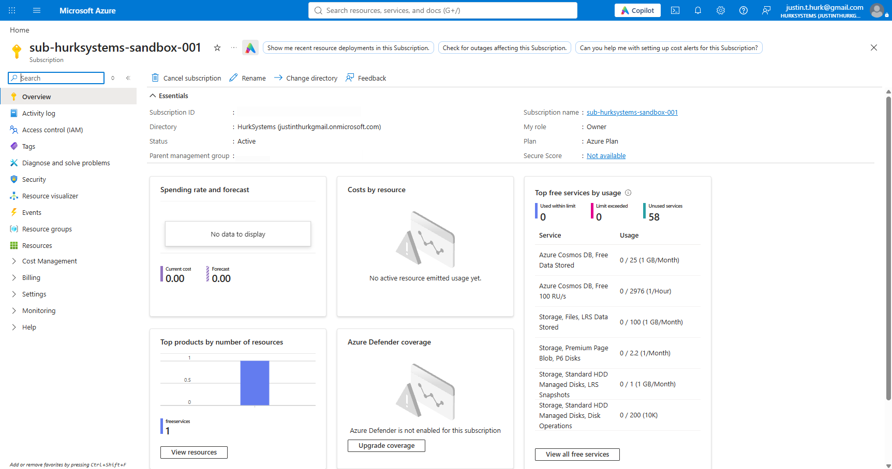
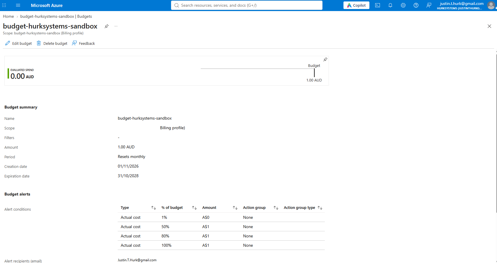

# 01 – Subscription and Cost Management

## Overview

The initial phase of the HurkSystems Azure infrastructure project focuses on establishing an Azure subscription and implementing cost management controls before deploying cloud resources.

HurkSystems is a fictional organisation used to simulate an enterprise Microsoft Azure environment.

## Objective

Establish a dedicated sandbox subscription and implement cost monitoring to minimise the risk of unexpected Azure charges.

## Subscription Configuration

| Setting | Configuration |
|---|---|
| Subscription name | `sub-hurksystems-sandbox-001` |
| Subscription type | Pay-As-You-Go |
| Environment | Sandbox |
| Microsoft Entra tenant | HurkSystems |
| Billing agreement | Microsoft Customer Agreement |
| Subscription status | Active |

### Subscription Overview

## Naming Convention

The following naming convention has been adopted for Azure subscriptions:

`sub-<organisation>-<environment>-<instance>`

| Component | Description | Example |
|---|---|---|
| sub | Subscription identifier | sub |
| Organisation | Organisation name | hurksystems |
| Environment | Deployment environment | sandbox |
| Instance | Unique instance number | 001 |

This convention provides consistent identification and allows additional subscriptions to be introduced without naming conflicts.

## Budget Configuration

A monthly budget was configured to monitor Azure spending and provide notifications when defined thresholds are reached.

| Setting | Configuration |
|---|---|
| Budget name | `budget-hurksystems-sandbox` |
| Scope | Billing profile |
| Budget amount | $1.00 |
| Reset period | Monthly |
| Alert type | Actual cost |
| Alert thresholds | 1%, 50%, 80%, 100% |
| Notification method | Email |

### Budget Configuration Evidence

## Design Decisions

### Pay-As-You-Go Subscription

A Pay-As-You-Go subscription was selected to provide access to Azure services without requiring a fixed monthly commitment.

This model supports practical experimentation while allowing resources to be deployed and removed as required.

### Subscription Naming Convention

A structured naming convention was implemented to maintain consistency across the Azure environment.

The instance identifier `001` allows for future expansion if additional subscriptions are required.

### Cost Management

A low monthly budget was established to provide early notification of unexpected resource consumption.

The budget was configured at the billing profile scope to align cost monitoring with the organisation's billing structure.

## Validation

The following checks were performed:

- [x] Azure Pay-As-You-Go subscription created.
- [x] Subscription renamed