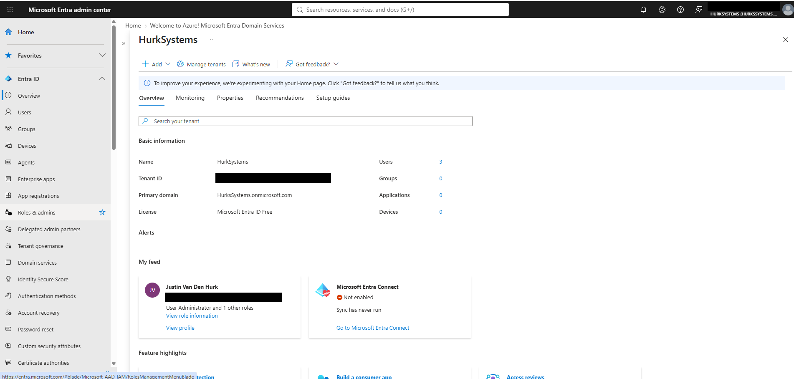
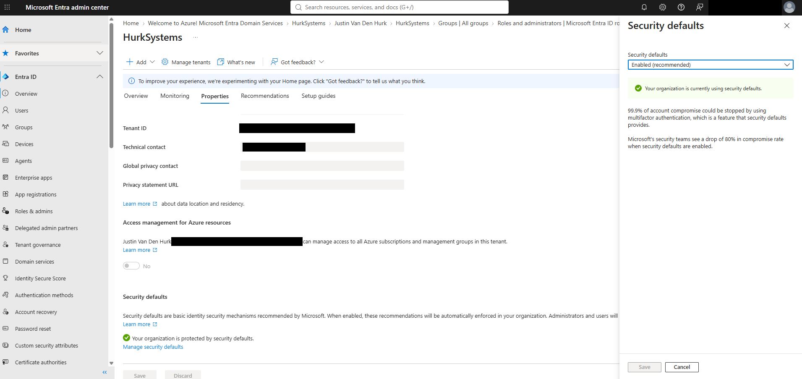
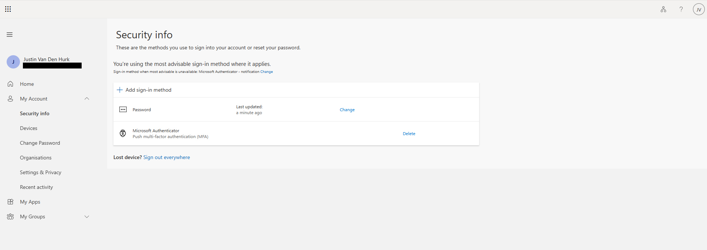
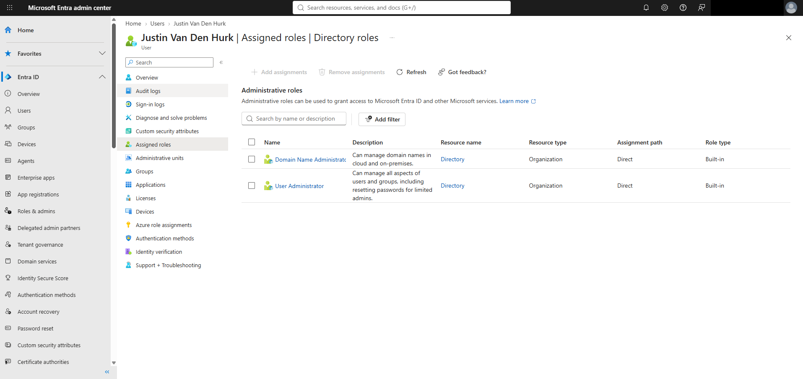
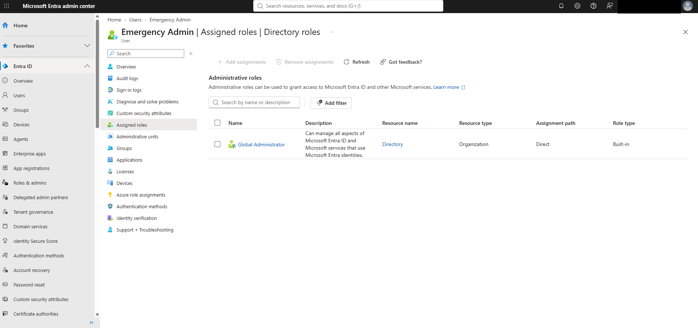

# Phase 02 – Tenant Configuration

## Objective

Establish a secure Microsoft Entra ID tenant for the
HurkSystems Azure environment, implementing baseline
identity security controls and least-privilege
administrative access.

## Tenant Configuration

The Microsoft Entra ID tenant was configured to reflect
the HurkSystems organisation and provide a central
identity management platform for the Azure environment.

| Configuration | Value |
| --- | --- |
| Tenant name | HurkSystems |
| Primary domain | hurkssystems.onmicrosoft.com |
| Licence | Microsoft Entra ID Free |
| Identity model | Cloud-only |

An additional Microsoft-managed domain was configured
and designated as the primary domain. Internal user
accounts were updated to use the new domain.

The original Microsoft-managed domain remains associated
with the tenant.

## Security Configuration

### Security Defaults

Security Defaults were verified as enabled within
the HurkSystems Microsoft Entra ID tenant.

This provides baseline identity security controls,
including multifactor authentication requirements
and protection against legacy authentication.

### Multifactor Authentication

Microsoft Authenticator was registered as an
authentication method for the daily administrator
account.

This provides an additional layer of identity
protection beyond password-based authentication.

### Azure Resource Access Elevation

Access management for Azure resources was verified
as disabled for the daily administrator account.

Microsoft Entra administrative roles and Azure
role-based access control (RBAC) are managed
separately to maintain appropriate access boundaries.

## Administrative Access

### Daily Administrator

A dedicated administrative account was configured
for routine identity management operations.

The following Microsoft Entra directory roles
were assigned:

| Role | Purpose |
| --- | --- |
| User Administrator | Manage users, groups and supported password reset operations |
| Domain Name Administrator | Manage tenant domain names |

The daily administrator account does not hold
the Global Administrator role.

This configuration follows the principle of least
privilege by limiting administrative permissions
to operational requirements.

### Emergency Administrator

A dedicated emergency administrator account was
created and assigned the Global Administrator role.

This account is intended for emergency tenant
administration and recovery rather than routine
administrative operations.

## Design Decisions

| Decision | Rationale |
| --- | --- |
| Cloud-only identity | Avoids unnecessary on-premises infrastructure |
| Microsoft Entra ID Free | Minimises licensing costs within the sandbox |
| Microsoft-managed domain | Avoids additional domain registration costs |
| Security Defaults | Provides baseline identity protection |
| Least-privilege administration | Reduces unnecessary administrative access |
| Dedicated emergency account | Provides an alternative privileged access path |

## Validation

- [x] Tenant display name configured
- [x] Primary domain configured
- [x] Internal user principal names updated
- [x] Security Defaults enabled
- [x] Administrator MFA registration evidenced
- [x] Daily administrator roles verified
- [x] Emergency administrator role verified
- [x] Azure resource access elevation disabled for daily administrator

## Limitations

Microsoft Entra ID Free was selected to minimise
operational costs within the sandbox environment.

Advanced identity governance capabilities, including
Conditional Access and Privileged Identity Management,
were not implemented due to licensing requirements.

Individual MFA registration across all accounts and
emergency access recovery testing were not performed
as part of this phase.

## Outcome

The HurkSystems Microsoft Entra ID tenant has been
configured with baseline identity security controls,
a dedicated primary domain and separate administrative
accounts.

This establishes the identity foundation required
for subsequent Azure infrastructure deployment
and access management.

## Next Phase

Phase 03 – Identity and Access Management

The next phase will focus on security groups,
user management, Azure RBAC and resource access
permissions.
